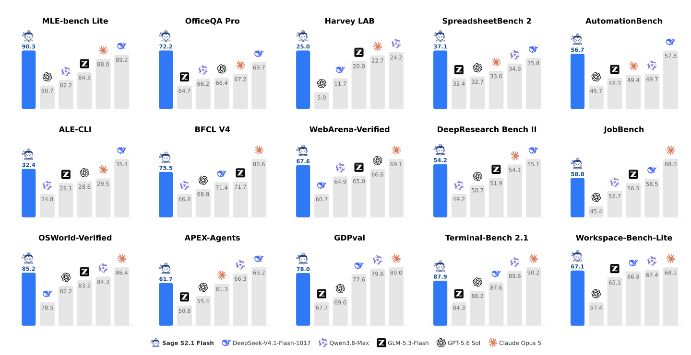

# Sage 2.1 Flash | Explore through reasoning. Verify through action.

Today, we introduce **Sage 2.1 Flash**, a frontier scientific multimodal agent model for demanding scientific research. Built on a **320-billion-parameter MoE architecture**, it combines scientific multimodal understanding with general agent capabilities, supporting scientific deep research, scientific programming and the operation of professional research software.

Sage 2.1 Flash incorporates more than ten types of scientific input into a unified model, including molecular graphs, crystal structures, protein sequences and three-dimensional structures, DNA and RNA sequences, spectra, mass spectra, X-ray diffraction, electrocardiograms, electroencephalograms and light curves. Large-scale training in verifiable environments strengthens its capabilities in search, programming, tool use and multistep task execution. Through visual feedback, the model can check its judgments against software states and intermediate results, adjust its strategy and advance complex tasks in professional research environments.

Scientific research requires repeated analysis, operation and inspection across data, code and professional tools. The following demonstrations show how Sage 2.1 Flash processes scientific data, operates professional software and uses intermediate results to adjust its execution, producing outputs that researchers can review.

## Demo

### CT Reconstruction

From 12,487 CT images with mixed sources, shuffled order and inconsistent orientations, the model identifies 139 slices from a single scan, corrects their orientation and restores the sequence. It revises its ordering strategy based on consistency checks, reconstructs three-dimensional bony structures in 3D Slicer, and returns to the source slices to verify local details.

- [Video Demo | CT Reconstruction](/cases/sage/ct.mp4)

### 3D Modeling

Using reference images, the model builds architectural, aerospace engine and truck chassis models in Blender and CAD software. It reviews the results through render previews or assembly checks and delivers editable models and presentation videos.

- [Architecture](/cases/sage/architecture.mp4)
- [Aerospace Engine](/cases/sage/engine.mp4)
- [Truck Chassis](/cases/sage/chassis.mp4)

### Scientific Analysis

Starting from a fluorescence microscopy image, the model adjusts segmentation thresholds in Fiji, separates touching nuclei and overlays the contours on the source image for inspection. It exports ROIs and measurements for review and further analysis.

- [Microscopy Analysis](/cases/sage/microscopy.mp4)
- [EEG Signal Processing](/cases/sage/eeg-v2.mp4)
- [Satellite Imagery Analysis](/cases/sage/satellite.mp4)
- [Scientific Multimodal Understanding](/cases/sage/scientific-understanding.mp4)

### Interactive Scientific Visualization

The model investigates efficiency losses in crystal quantum memories by reviewing primary papers, extracting experimental parameters and comparing cavity coupling, atomic dephasing and losses through parameter sweeps. The interactive page lets visitors adjust reflectivity, absorption and storage time, observe pulses and echoes, and trace the evidence to papers and research records.

- [The Memory of Light](/cases/sage/light-memory.html)
- [Crystal Structure Visualization](/cases/sage/crystal-structures.html)

Sage 2.1 Flash is designed for scientific reasoning and agentic task execution, supporting analysis that combines scientific data, retrieval, programming and professional software.

Try the model through its API and explore its applications in research data processing, professional software operation and multistep task execution.

[Try the Sage 2.1 Flash API →](https://discovery.intern-ai.org.cn/)
