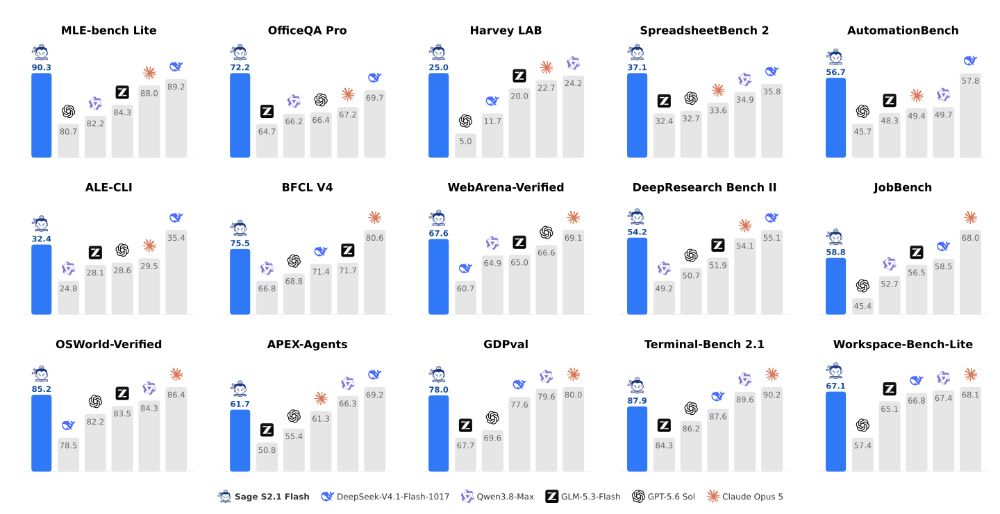

# Sage 2.1 Flash ｜ 以推理探索，以行动求证

今天，我们正式发布 **书生 Sage 2.1 Flash**，一款面向高难度科学研究的前沿科学多模态智能体模型。模型采用 **3200 亿参数 MoE 架构**，将科学多模态理解与通用智能体能力相结合，支持科学深度研究、科学编程及专业科研软件操作。

书生-S2.1 将分子图、晶体结构、蛋白质序列与三维结构、DNA序列、RNA序列，以及光谱、质谱、X 射线衍射、心电、脑电和光变曲线等十余类科学输入纳入统一模型，并依托大规模可验证环境训练，强化搜索、编程、工具调用与多步骤任务执行能力。通过视觉反馈，模型能够根据软件状态与中间结果检验判断、调整策略，在专业科研环境中持续推进复杂任务。

科学研究需要在数据、代码与专业工具之间反复开展分析、操作和检查。以下演示展示 Sage 2.1 Flash 如何处理科学数据、操作专业软件，并利用中间结果调整执行过程，输出可供研究者复核的成果。

## Demo

### CT 三维重建

从 12,487 张来源混杂、顺序打乱且朝向不一的 CT 图像中，筛出同一次扫描的 139 张切片，校正朝向并恢复层序。模型根据一致性检查调整排序策略，在 3D Slicer 中完成三维骨骼重建，并回查原始切面复核局部细节。

- [视频演示｜CT 三维重建](/cases/sage/ct.mp4)

### 三维建模

根据参考图，在 Blender 与 CAD 软件中完成建筑、航天发动机和汽车底盘的三维建模，结合渲染预览或装配检查复核结果，输出可编辑模型与展示视频。

- [建筑三维重建](/cases/sage/architecture.mp4)
- [航天发动机](/cases/sage/engine.mp4)
- [汽车底盘](/cases/sage/chassis.mp4)

### 科研分析

从荧光显微图出发，在 Fiji 中调整分割阈值、分离粘连细胞核，将轮廓叠回原图检查，并导出 ROI 与测量结果，便于复核和后续分析。

- [显微图分析](/cases/sage/microscopy.mp4)
- [脑电信号处理](/cases/sage/eeg-v2.mp4)
- [卫星影像分析](/cases/sage/satellite.mp4)
- [科学多模态理解](/cases/sage/scientific-understanding.mp4)

### 科学交互可视化

围绕晶体量子存储中的效率损失，模型检索原始文献、提取实验参数，并通过参数扫描比较腔耦合、原子失步与损耗的影响。交互页面可调节反射率、吸收强度和存储时间，观察光脉冲与回波的变化，并追溯对应的文献与研究记录。

- [光的记忆](/cases/sage/light-memory.html)
- [晶体结构可视化](/cases/sage/crystal-structures.html)

Sage 2.1 Flash 面向科学推理与智能体任务执行，支持结合科学数据、检索、编程与专业软件开展分析。

欢迎通过 API 体验模型能力，探索其在科研数据处理、专业软件操作与多步任务执行中的应用。

[试用 Sage 2.1 Flash API →](https://discovery.intern-ai.org.cn/)
